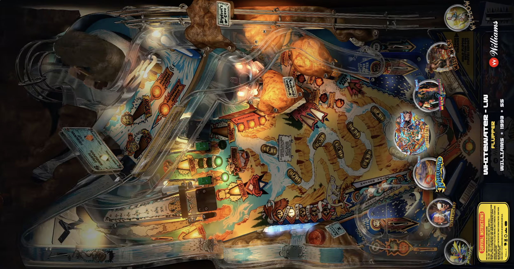

# CommunityMOD

A theme only for a cabinet, based on Trinidad original theme. 

The playfield is the table's video or image, whichever Playfield Media Priority in VPinFE's settings asks for.  A table with neither leaves the screen black, and a table with no wheel is named in the arc.

## Install

Open Themes in the Console, find CommunityMOD, and press Install.  Then press Make Active and restart VPinFE.  It needs VPinFE 3.0 or later.